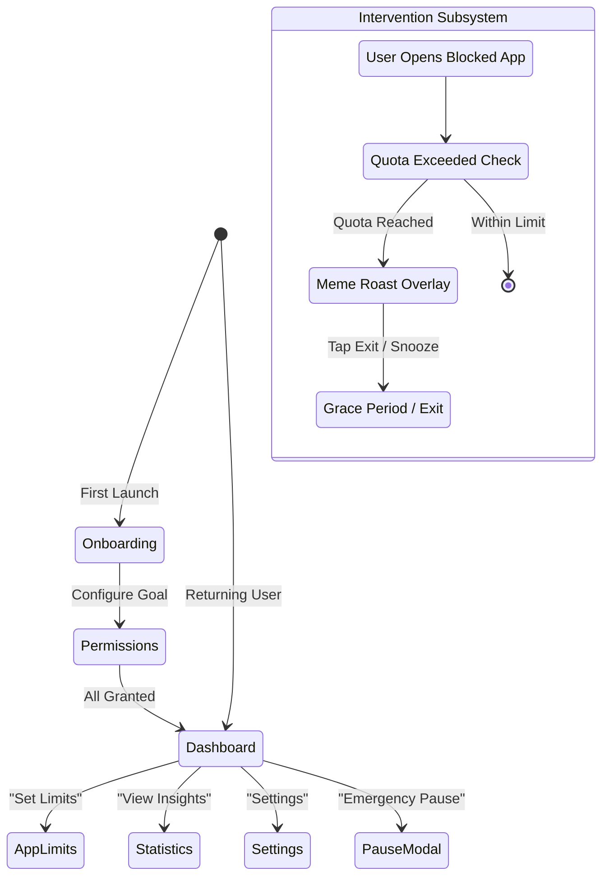

# 02 - Navigation Flows: BrainPal

## Primary User Navigation Flows

## Detailed Navigation Transitions

### Flow 1: Onboarding & Permissions
1. `SplashScreen` -> checks if onboarding completed (`UserPrefBoolean.HAS_COMPLETED_ONBOARDING`).
2. If `false`:
   - `OnboardingGoalScreen`: Select daily reel targets and blocked apps.
   - `PermissionStepScreen(USAGE_STATS)`: Guides user to system settings with deep link `Settings.ACTION_USAGE_ACCESS_SETTINGS`.
   - `PermissionStepScreen(OVERLAY)`: Guides user to `Settings.ACTION_MANAGE_OVERLAY_PERMISSION`.
   - `PermissionStepScreen(ACCESSIBILITY)`: Explains reels scrolling detection, opens accessibility settings.
   - `OnboardingSuccessScreen`: Mascot celebration (`confetti.lottie`, `welcome_ting.mp3`), transitions to `Dashboard`.

### Flow 2: Core Dashboard Navigation (Bottom Navigation / Tabs)
The main navigation hosts 4 key destinations:
1. **Home / Dashboard**: Live buddy mascot, today's reel count, quick toggles (Strict Mode, Snooze).
2. **App Limits**: List of apps with active limits, toggle switch, time quota sliders.
3. **Analytics / Stats**: Hourly usage graphs, daily breakdowns, comparison with yesterday.
4. **Settings**: Language selector for meme roasts, sound toggles, notification schedule, app version.

### Flow 3: Real-Time Intervention Flow
1. Background watcher detects foreground package matching blocked app list (e.g. `com.instagram.android`).
2. Checks remaining daily quota and session quota:
   - If quota remaining > 0: Launches `ReelsCounterFloatingService` (floating pill overlay) to track scrolls in real time.
   - If quota exceeded: Launches `BlockReelsOverlayActivity` with `FLAG_ACTIVITY_NEW_TASK | FLAG_ACTIVITY_CLEAR_TOP`.
3. In `BlockReelsOverlayActivity`:
   - Displays randomized meme roast from `roast_gifs.json` matching chosen language pool.
   - User can click "Close App" (dispatches `Intent(Intent.ACTION_MAIN).addCategory(Intent.CATEGORY_HOME)`).
   - Or user can click "5 Minute Emergency Pass" (deducts 1 pass, grants 5 min grace period).

